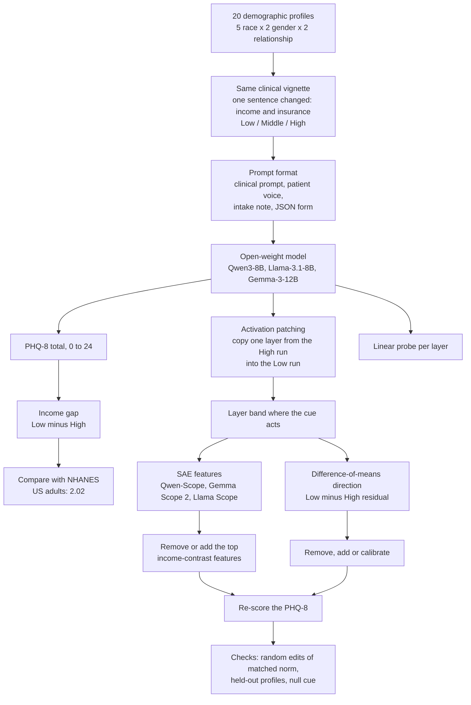

# PsychScope

*Income-cue bias in LLM depression scoring: where it acts inside the model, and how much interpretability tools can see of it.*

**Status: research in progress, October 2026.**

PsychScope tests whether open-weight language models score the same synthetic patient as more depressed when the only change in the prompt is an income and insurance cue, and where inside the model that difference forms. Qwen3-8B, Llama-3.1-8B-Instruct and Gemma-3-12B-it all rate the poorer patient higher on the PHQ-8, by 4 to 8 points. The size of the gap depends on the prompt format, and the format that inflates it most differs between models. Activation patching places the cue's effect in one narrow band of middle layers in each model, even though a linear probe reads income at almost every layer. Sparse-autoencoder features capture only part of that effect and behave differently in each model, while a simple difference-of-means direction gives a stronger handle in two of the three.

## Pipeline



## 1. The behavioural gap

Each model fills in a PHQ-8 (0 to 24) for the same clinical vignette with one sentence changed, the patient's income and insurance level (Low, Middle or High). The Low minus High difference is the gap. The grid is 20 demographic profiles (5 race x 2 gender x 2 relationship), two framings and two paraphrases, with 320 generations per level at temperature 1.0 and a cluster bootstrap over the 80 prompt cells.

| Model | Low / Middle / High | Gap (Low - High) | 95% CI |
|---|---|---|---|
| Qwen3-8B | 9.14 / 5.42 / 1.37 | 7.77 | [7.40, 8.14] |
| Llama-3.1-8B-Instruct | 12.36 / 7.28 / 5.26 | 7.09 | [6.60, 7.59] |
| Gemma-3-12B-it | 14.83 / 11.44 / 10.79 | 4.03 | [3.69, 4.38] |

Low scored above High in 80 of 80 prompt cells in every model. Removing the literal level word from the cue sentence left the gap unchanged in all three models (Qwen +0.34 [-0.17, 0.88], Llama -0.10 [-1.08, 0.86], Gemma -0.43 [-0.89, 0.02]). The same cue moves GAD-7 by +4.70 (Qwen), +5.25 (Llama) and +4.15 (Gemma) points (greedy, n = 20 per level).

## 2. The prompt format changes the size of the gap

The same cue sentence and item wording were placed in four prompt formats. Greedy decoding, 20 profiles, 95% paired bootstrap intervals. For reference, the PHQ-8 gap between low- and high-income US adults is 2.02 points (survey-weighted NHANES 2005-2018, built in the [Validity Ladder repository](https://github.com/pskeough/A-Validity-Ladder-for-LLM-Simulated-Populations)).

| Format | Qwen3-8B | Llama-3.1-8B |
|---|---|---|
| Clinical prompt (shows an example answer array) | 6.90 [5.75, 8.10] | 8.65 [7.20, 10.20] |
| Patient's own voice | 7.55 [6.60, 8.50] | 9.70 [8.85, 10.50] |
| Clinician intake note | **13.90** [12.90, 14.80] | 6.65 [5.95, 7.35] |
| JSON form | 6.70 [5.65, 7.85] | **14.40** [13.85, 15.00] |

Every format sits 3 to 7 times above the population gap, and the format that inflates it most is different in each model. A "times the population gap" figure therefore holds only for the format it was measured in. Gemma was not run on this comparison. Qwen's intake-note High scores are near-templated, with totals of 0 or 3 in all 20 profiles.

Telling the model not to let income affect its answers does not fix the gap. The gap widened in Qwen (+2.55 [1.50, 3.70]), did not change in Llama (+0.25 [-1.40, 1.80]) and narrowed in Gemma (-2.00 [-2.70, -1.30]) only because Gemma raised its High and Middle scores.

## 3. Where the cue acts

Activation patching copies one layer's residual stream at the cue positions from the High-income run into the Low-income run and measures how much of the gap moves. Each model has one contiguous band in the middle of the network.

| Model | Band (share moved >= 0.10) | Peak | Depth fraction |
|---|---|---|---|
| Qwen3-8B (36 layers) | 16 to 22 | 0.79 [0.71, 0.88] at layer 18 | 0.44 to 0.61 |
| Llama-3.1-8B (32 layers) | 10 to 14 | 0.56 [0.42, 0.68] at layer 12 | 0.31 to 0.44 |
| Gemma-3-12B (48 layers) | 18 to 26 | 0.82 [0.77, 0.87] at layer 20 | 0.375 to 0.54 |

In Qwen a single-layer patch at layers 24, 27 and 30 moves nothing, and patching all 36 layers moves 0.965. A linear probe reads the income level at ceiling at nearly every layer in all three models, inside and outside the band, so decodability does not locate where the model uses the cue.

## 4. What SAE features capture

Features come from Qwen-Scope (64K, TopK, trained on the base model) for Qwen, Gemma Scope 2 (16K, JumpReLU, instruct-trained) for Gemma and Llama Scope for Llama. "Remove" clamps the cue-contrast features toward their High-income values in the Low-income run. "Add" pushes them toward Low-income values in the High-income run. Greedy decoding, 20 profiles.

| Setting | Add features | Remove features | Raw patch, same layers |
|---|---|---|---|
| Qwen3-8B, layers 27 and 33 | +2.65 [1.70, 3.60] points | 0.000, -0.006, 0.000 of the gap (10, 20, 50 features) | 0.000 to 0.006 |
| Qwen3-8B, layers 21, 24, 27, 30, 33 | | 0.076 [0.045, 0.108] (50 features) | 0.390 |
| Gemma-3-12B, layers 36 and 44 | +0.10 [-0.15, 0.35] points | 0.31, 0.41, 0.45 (10, 20, 50 features) | |
| Llama-3.1-8B, layer 14 (in band) | | 0.17 [0.08, 0.25] (50 features); norm-matched random 0.03 | |

- The Qwen addition partly copies an example answer array shown in the prompt. A copy-adjusted bound is +1.88 [0.72, 3.07].
- Most of the Qwen SAE layers sit after the band in section 3, so a removal null there is predicted by placement alone. The one in-band Qwen removal (50 features at layer 18) moved Low scores the wrong way, +1.65 [1.25, 2.10].
- At layer 18, swapping in the SAE reconstruction pushes scores up by +3.50 on its own. After subtracting that push, the reconstructed patch carries 0.355 [0.273, 0.456] of the gap against 0.791 for the raw patch. A sentiment contrast keeps the same share (0.450 against 0.449), so the shortfall is general reconstruction loss and is not specific to income.
- In Llama, at the in-band layer, the top 10 contrast features do no better than a random edit of the same norm (clamp minus random -0.55 [-1.55, 0.40]).
- Qwen responds to adding features and Gemma to removing them. The two setups differ in SAE width, activation function, training base, quantisation and the layers edited, so the contrast is not a property of the models.

My reading is that SAE features give a partial and model-specific view of the income effect, and that a feature null means little until the layer has been checked against the patching band.

## 5. A difference-of-means direction

A single direction, the mean residual difference between Low- and High-income prompts, is a stronger handle than the SAE features in two of the three models.

- **Llama.** Removing the direction at every layer removes 1.12 [1.02, 1.23] of the gap on the clinical prompt and 0.94 to 1.26 in the three formats it was never fitted on. Adding it at layer 12 recreates about one gap.
- **Qwen.** The direction fitted on the clinical prompt transfers only partly. Removal takes out 0.46 of the gap on the clinical prompt, 0.53 in the JSON form and close to nothing in the patient-voice and intake-note formats.
- **Gemma.** Every direction edit strong enough to move the gap broke the output format, so Gemma has no usable direction edit at these strengths.
- **Held-out profiles.** On 30 new profiles the calibration edits removed the same share of the gap as in-sample (Llama calibrated gap 3.53 against 3.70 in-sample; Qwen fraction removed 0.72, no attenuation). In Qwen the edit narrows the gap by moving all three levels toward the middle, not toward population levels.
- **Null cue.** A run with favourite colour in place of income raised no flag on Qwen. On Llama, a direction fitted on the colour contrast moved scores by about 1.4 points more than a random direction, and removing the income direction lowered scores on prompts with no income cue (-5.1 [-6.35, -3.8]). The Llama direction results are marked weakened until a mean-ablation control runs.

## Related work

PsychScope sits inside a series. [Plausible Patients, Impossible Populations](https://arxiv.org/abs/2604.17359) (arXiv 2604.17359 v2) scored 28,800 simulated PHQ-8 assessments from four API models against survey-weighted NHANES anchors and found every benchmarkable group inflated by 2.8 to 5.5 points while individual cases stayed clinically coherent. [A Validity Ladder for LLM-Simulated Populations](https://github.com/pskeough/A-Validity-Ladder-for-LLM-Simulated-Populations) (under review at Behavior Research Methods) turns that into a set of checks against human data. PsychScope moves to open-weight models so the same kind of demographic distortion can be traced inside the network.

## Layout

```
results/analysis/   per-experiment summary.json files, layer-placement and probe
                    outputs, RECEIPTS.md
results/runs/       per-run summaries for the behavioural grids and causal pilots
pipeline/           scripts for the behavioural grids and causal pilots
```

`results/analysis/RECEIPTS.md` maps each number in this README to the file and row it was computed from. The scripts for the format, direction and null-cue experiments are being cleaned for release.

## Setup

Qwen3-8B (8-bit bitsandbytes), Llama-3.1-8B-Instruct (8-bit) and Gemma-3-12B-it (QAT 4-bit, `unsloth/gemma-3-12b-it-qat-bnb-4bit`), one checkpoint per family. Effect directions hold across quantisation and magnitudes do not (Qwen greedy gap 8.6 at 8-bit, 5.1 at 4-bit). The split between primary and exploratory results was drawn after the data were seen. Analysis re-derivation, receipts and parts of the text were produced with Claude agents under my direction.

## Citation

```
@misc{keough2026psychscope,
  title  = {PsychScope: Income-Cue Bias in LLM Depression Scoring and What Interpretability Can See of It},
  author = {Keough, Patrick},
  year   = {2026},
  note   = {Code and results},
  url    = {https://github.com/pskeough/psych_scope}
}
```

## License

Code: MIT ([LICENSE](LICENSE)) · Results and derived data: CC BY-NC-ND 4.0 ([LICENSE-DATA](LICENSE-DATA))
